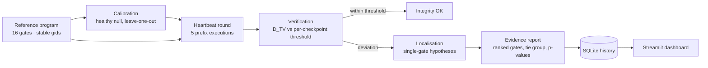

<div align="center">

# Quantum Arise

**VTU-QFF-HC-0037** &nbsp;|&nbsp; Tier: **Both**

**Project: QuantumPulse** — heartbeat-based quantum circuit integrity monitoring
and gate-tampering localisation

</div>

---

<div align="center">

| | |
| :--- | :--- |
| **Team** | Quantum Arise |
| **Team ID** | VTU-QFF-HC-0037 |
| **Tier** | Both |
| **Repository** | [vtu-hc-quantum-arise](https://github.com/vtu-qiskit-fall-fest-2026/vtu-hc-quantum-arise.git) |
| **Organisation** | [vtu-qiskit-fall-fest-2026](https://github.com/vtu-qiskit-fall-fest-2026) |
| **Event** | VTU-QFF Hackathon — VTU-Qiskit Fall Fest 2026 |

</div>

---

## 📌 Table of Contents

- [Team Members](#-team-members-github-ids)
- [Problem Statement](#-problem-statement)
- [Proposed Solution](#-proposed-solution)
- [Approach & Architecture](#-approach--architecture)
- [Measured Results](#-measured-results)
- [Tech Stack](#-tech-stack)
- [Project Structure](#-project-structure)
- [How to Run](#-how-to-run)
- [How to Push Code](#-how-to-push-code)
- [Submission Checklist](#-submission-checklist)
- [Resources](#-resources)
- [License](#-license)

---

## 👥 Team Members (GitHub IDs)

> Members are added to this repository as **collaborators** and must accept the
> GitHub invitation before they can push. Add your GitHub username below.

| # | Name | GitHub Username | Role |
| :-- | :--- | :--- | :--- |
| 1 | D V Jagadeep Reddy | venkata-jagadeep-reddy | _Team Lead_ |
| 2 | Matam Darshan | MatamDarshan | _Developer_ |
| 3 | Yemula Venkatkarthikeyan | venkatkarthikeyan06 | _Developer_ |

---

## ❓ Problem Statement

**Problem:** A quantum program is frequently compiled, transpiled and executed by
someone other than its author — a cloud provider, a colleague, a shared queue.
Once the program leaves the author's hands, nothing verifies that the circuit
that actually ran is the circuit that was intended. Existing checks are
*static*: they prove properties of a description before it runs, assuming the
description is the one that executes. If a gate is swapped, an angle altered or a
rotation removed somewhere between design and execution, the program still runs
and still returns plausible-looking results — the corruption is silent.

**Why it matters:** The failure mode is not a crash, it is a *wrong answer that
looks right*. In a hybrid workflow (quantum kernel + classical model, variational
optimisation, error mitigation loops) a silently modified gate can shift a
measurement distribution just enough to move a downstream decision, and there is
no way to tell from the output alone. Detecting the change after the fact
requires re-running the intended circuit and comparing distributions; pointing
at *which* gate changed — the part a human actually needs — is harder still.

**Track / Category:** _Online / Offline · Track 1 / Track 2 · <domain>_

---

## 💡 Proposed Solution

**Solution:** QuantumPulse turns the circuit into a *heartbeat*: the program is
split at five checkpoints, and every monitoring round re-executes each prefix
and compares the measured outcome distribution against a calibrated, noise-aware
healthy reference using total-variation distance. When a checkpoint deviates,
the earliest deviating checkpoint bounds the search space, every candidate gate
is mutated (replaced / removed / angle-altered) in a copy of the *reference*
program, and the hypothesis that best reproduces the observation is ranked
first. The result is an evidence report — per-checkpoint distance, threshold,
p-value, noise floor, ranked suspect gates, and an explicit tie group when the
circuit provably cannot distinguish two candidates.

**Key idea:** *Measure behaviour, not intent — re-execute circuit prefixes as
heartbeats, compare each against a calibrated null with a total-variation
distance, then differential-test single-gate hypotheses to name the tampered
gate.*

**Why this works:** The heartbeat prefix executions are exact re-runs of the
same program on the same backend, so a deviation is a property of the executed
circuit rather than of the noise model (the noise affects the reference and the
observation identically, and is calibrated out). The detection statistic is
derived from an empirical null instead of a guess, which makes the
false-positive rate an explicit, measured quantity. Localisation compares
*hypothesised* circuits against the *observed* data rather than against another
hypothesis, so the ranking is evidence, not a heuristic. Where two hypotheses
produce bit-identical distributions the system reports a tie group with the
measured margin instead of inventing a winner.

---

## 🧩 Approach & Architecture



1. **Input** — a declarative `QuantumPulseProgram`: an ordered list of gate
   records with stable ids (`g00…g15`), so removing a gate never shifts a
   checkpoint position. The reference circuit is 4 qubits / 16 gates / 5
   checkpoints.
2. **Preprocessing / calibration** — the healthy circuit is executed 200 times
   under the *same* noise model and shot count. Each run's `D_TV` is computed
   against the leave-one-out mean of the others, and the alert threshold is the
   `1 − alpha` quantile of that null with a Gaussian floor. The noise floor
   (`D_TV` between the noisy and the ideal state) is reported as evidence.
3. **Quantum core** — Qiskit Aer simulation of the circuit prefixes. Each
   checkpoint re-runs the exact gate prefix that precedes it, so the heartbeat
   is a genuine re-execution, not an estimate. Noise models: ideal, mild and
   strong depolarising, and a thermal `T1/T2` model.
4. **Post-processing / scoring** — total-variation distance per checkpoint
   against the calibrated null, with an empirical p-value
   `p = (1 + #{d_i ≥ d_obs}) / (N + 1)`. A round is flagged when any checkpoint
   exceeds its threshold; the union bound `k · alpha` is printed in every
   report. Localisation then scores each candidate gate by the *mean* `D_TV`
   between the observation and the best matching single-gate hypothesis, fused
   over up to three deviating checkpoints.
5. **Output** — a text or JSON integrity report (per-checkpoint distances,
   thresholds, p-values, noise floor, ranked suspect gates with confidence and
   margin, tie group, family-wise false-positive bound), a SQLite audit trail,
   and a Streamlit dashboard for live monitoring and review.

---

## 📊 Measured Results

Full matrix: 117 tampering scenarios × 3 trials × 4 noise profiles, 100
seed-disjoint healthy rounds per profile. **Every number below is produced by
the code in this repository** — nothing is hand-written.

| Metric | Result |
| :--- | :--- |
| Detection over the full catalogue | 0.932 – 0.940 |
| Detection over **detectable** scenarios | **1.000** (327 / 327) in every profile |
| Strict top-1 gate localisation | 0.950 – 0.972 |
| Top-1 or reported tie group | **1.000** in every profile |
| Top-3 localisation | 1.000 (output-only baseline: 0.986 worst case) |
| Strict top-1, heartbeat vs output-only | 0.972 vs 0.899 under strong noise |
| Strict top-1, evidence-fusion ablation | 0.853 (1 checkpoint) → **0.954** (3 checkpoints) |
| Run-level false-positive rate, `alpha = 0.005` | 0.022 ideal (500 rounds); 0.060–0.070 noisy |
| Run-level false-positive rate, recommended `alpha/k = 0.001` | **0.002** ideal; **0.010–0.015** noisy |
| Heartbeat round overhead | 5.12× – 5.24× a single output-only run |

8 of the 117 scenarios are *provably undetectable* — they leave every
checkpoint distribution bit-identical, computed with the statevector
simulator — which is why catalogue-wide detection is 0.932–0.940 while every
detectable scenario is caught in every trial. The strict top-1 misses are
identifiability limits: a different single-gate change produces an identical
distribution, so a tie group is reported instead of a fabricated winner.

Full tables, including per-noise-profile breakdowns, the ablations and the
false-positive study: **[`docs/results.md`](docs/results.md)**. The extended
technical write-up lives in
**[`README_QUANTUMPULSE.md`](README_QUANTUMPULSE.md)**.

---

## 🛠️ Tech Stack

| Layer | Technology |
| :--- | :--- |
| Language | Python 3.12 |
| Quantum SDK | Qiskit `1.4.6`, Qiskit Aer `0.18.0` (statevector + shot simulation) |
| Noise modelling | Aer noise models — depolarising, thermal `T1/T2` |
| Statistics | NumPy `2.5`, SciPy `1.18` — total variation distance, empirical p-values, null quantiles |
| Optional ML comparison | scikit-learn — Isolation Forest (secondary detector, measured, not assumed) |
| Dashboard | Streamlit (+ Plotly) |
| Persistence | SQLite (`sqlite3` stdlib) |
| Packaging / tooling | `pyproject.toml`, `pytest`, `ruff`, `Makefile`, Docker |
| Version control | Git + GitHub |

> No Qiskit Optimisation component is used: this problem is a runtime
> *monitoring* problem, not an optimisation problem, and adding a variational
> solver would not have answered it.

---

## 📁 Project Structure

```text
vtu-hc-quantum-arise/
├── README.md                  # This file — project overview (hackathon template)
├── README_QUANTUMPULSE.md     # Detailed technical README (architecture, results, usage)
├── requirements.txt           # Python dependencies
├── pyproject.toml             # Package metadata + console script
├── Dockerfile                 # Container image
├── Makefile                   # calibrate / evaluate / test / dashboard shortcuts
├── .gitignore
├── notebooks/                 # Jupyter notebooks for experiments
│   └── exploration.ipynb      # Working end-to-end demo (outputs cleared)
├── src/quantumpulse/          # The QuantumPulse package
│   ├── program.py             # Declarative circuit model, stable gate ids
│   ├── circuits.py            # Reference circuit + design rationale
│   ├── backends.py            # Qiskit Aer wrapper (counts + exact statevector)
│   ├── execution.py           # Heartbeat and full-circuit execution
│   ├── detection.py           # D_TV, JS, KL, Hellinger, chi-square
│   ├── calibration.py         # Healthy null + threshold selection
│   ├── verification.py        # Decision rule -> per-checkpoint verdicts
│   ├── tampering.py           # Controlled single-gate catalogue (117 scenarios)
│   ├── localization.py        # Differential hypothesis testing + tie groups
│   ├── evaluation.py          # Evaluation matrix and metrics
│   ├── evidence.py            # Text / JSON integrity report
│   ├── storage.py             # SQLite history
│   ├── monitoring.py          # Periodic monitoring session
│   ├── ml.py                  # Optional Isolation Forest comparison
│   ├── dashboard.py           # Streamlit application
│   └── cli.py                 # Command-line interface
├── scripts/                   # Reproducible studies
│   ├── calibration_study.py   # FPR vs calibration size
│   ├── fusion_ablation.py     # 1 vs 3 vs 5 fused checkpoints
│   ├── bonferroni_tradeoff.py # alpha/k: FPR guarantee vs detection cost
│   └── fpr_under_noise.py     # Run-level FPR under noise
├── data/                      # Calibration baseline + evaluation artefacts
├── tests/                     # Unit tests (66 tests)
│   ├── conftest.py            # Shared fixtures
│   ├── test_program.py        # Declarative program model
│   ├── test_detection.py      # Distance statistics
│   └── test_pipeline.py       # End-to-end detection + localisation
└── docs/                      # architecture, method, results, judge Q&A
```

| Document | Contents |
| :--- | :--- |
| [`README_QUANTUMPULSE.md`](README_QUANTUMPULSE.md) | Full technical README: pipeline, CLI, results, limitations |
| [`docs/architecture.md`](docs/architecture.md) | Pipeline, module map, execution model, limitations |
| [`docs/method.md`](docs/method.md) | Statistics, multiplicity, identifiability, what is *not* claimed |
| [`docs/results.md`](docs/results.md) | Measured tables per noise profile + ablations |
| [`docs/judge-qa.md`](docs/judge-qa.md) | Anticipated judge questions with honest answers |

---

## 🚀 How to Run

### Prerequisites

- Python 3.11 or newer
- [Git](https://git-scm.com/downloads)
- A GitHub account (you need collaborator access to this repo)

### 1. Clone the repository

```bash
git clone https://github.com/vtu-qiskit-fall-fest-2026/vtu-hc-quantum-arise.git
cd vtu-hc-quantum-arise
```

### 2. Create a virtual environment

```bash
python3 -m venv .venv
source .venv/bin/activate        # Linux / macOS
# .venv\Scripts\activate         # Windows (PowerShell)
```

### 3. Install dependencies

```bash
pip install --upgrade pip
pip install -r requirements.txt
```

### 4. Run

The package runs straight from the source tree:

```bash
# 1. calibrate the healthy reference (≈60 s)
PYTHONPATH=src python -m quantumpulse.cli calibrate --runs 200

# 2. inspect the reference circuit and the tampering catalogue
PYTHONPATH=src python -m quantumpulse.cli reference

# 3. monitor the healthy circuit
PYTHONPATH=src python -m quantumpulse.cli check

# 4. inject a controlled tampering scenario, detect and localise it
PYTHONPATH=src python -m quantumpulse.cli localize --tamper g00:replace:x --exact-sweep

# 5. dashboard
PYTHONPATH=src streamlit run src/quantumpulse/dashboard.py
```

Installed as a package (`pip install -e .`) the console script replaces the
`PYTHONPATH=src python -m quantumpulse.cli` prefix:

```bash
quantumpulse reference      # circuit, checkpoint layout, tampering catalogue
quantumpulse calibrate      # build and store the healthy null + thresholds
quantumpulse check          # one heartbeat verification
quantumpulse localize       # verify, then rank candidate gate locations
quantumpulse evaluate       # full evaluation matrix -> evaluation.json + CSVs
quantumpulse summarize      # render a saved evaluation as markdown tables
quantumpulse ml-evaluate    # calibrated D_TV vs the optional Isolation Forest
quantumpulse monitor        # periodic monitoring loop with SQLite history
quantumpulse report         # summarise stored monitoring history
```

Useful flags: `--noise {ideal,depolarizing_mild,depolarizing_strong,thermal}`,
`--shots`, `--alpha`, `--tamper <scenario-id-or-gate-id>`, `--json`,
`--exact-sweep`.

Or launch the notebook workflow:

```bash
jupyter lab
```

### 5. Run the tests

```bash
PYTHONPATH=src python -m pytest -q     # 66 tests
```

### 6. Reproduce the reported results

```bash
make calibrate      # data/baseline.json          (~60 s)
make evaluate       # data/evaluation/            (~30-45 min)
make summarize      # markdown tables from the saved evaluation
```

---

## 🔁 How to Push Code

> Full walkthrough: **[Git & Collaboration Handbook](../vtu-hc-guide-git-and-collaboration)** — collaboration
> workflow, branches, pull requests, reviews and conflict resolution.

### Configure Git (first time only)

```bash
git config --global user.name  "Your Name"
git config --global user.email "you@example.com"
```

### Everyday workflow

```bash
# 1. Get the latest changes
git checkout main
git pull origin main

# 2. Create a branch for your work
git checkout -b feature/my-task

# 3. Commit your work
git add .
git commit -m "feat: add variational circuit for the search problem"

# 4. Push the branch
git push -u origin feature/my-task

# 5. Open a Pull Request on GitHub and request a review
#    https://github.com/vtu-qiskit-fall-fest-2026/vtu-hc-quantum-arise/compare/main...feature/my-task

# 6. After approval, merge into main
git checkout main
git pull origin main
git branch -d feature/my-task
```

### Commit message convention

| Prefix | Meaning |
| :--- | :--- |
| `feat:` | New feature |
| `fix:` | Bug fix |
| `docs:` | Documentation only |
| `test:` | Adding or fixing tests |
| `refactor:` | Code restructure, no behaviour change |
| `chore:` | Build/config/dependency changes |

### Useful commands

```bash
git status              # what changed
git log --oneline -10   # recent commits
git diff                # review changes before committing
git stash                # shelve changes temporarily
git pull --rebase       # update your branch on top of main
```

### Collaborating on the same repo

- **Never push directly to `main`** — open a Pull Request.
- **Pull before you push** to avoid rejected commits.
- **Commit often** with clear messages.
- **Resolve conflicts** locally: `git pull --rebase`, fix the files, then `git add` + `git rebase --continue`.
- **Ask for a review** before merging — a second pair of eyes catches bugs fast.

---

## ✅ Submission Checklist

- [ ] Repository created and **public**
- [ ] All team members added as **collaborators** and invitations accepted
- [x] `README.md` updated with project details, problem statement and solution
- [ ] Team members listed under [Team Members](#-team-members-github-ids)
- [x] `requirements.txt` committed and project runs from a clean clone
- [ ] Code pushed to `main` and the latest `main` builds successfully
- [ ] Notebooks committed with **cleared outputs** (or use `nbstrip`)
- [ ] `README` includes a demo screenshot / video link
- [ ] Short project summary submitted on the hackathon portal

---

## 📚 Resources

| Resource | Link |
| :--- | :--- |
| 🔁 Git & collaboration handbook | [Git & Collaboration Handbook](../vtu-hc-guide-git-and-collaboration) |
| ❓ Problem statements, solutions & terms | [Problem Statements, Solutions & Terms](../vtu-hc-guide-problem-and-solution) |
| 📄 README writing guide | [README Guide & Template](../vtu-hc-guide-readme-template) |
| 📘 Project technical README | [README_QUANTUMPULSE.md](README_QUANTUMPULSE.md) |
| 📊 Measured results | [docs/results.md](docs/results.md) |
| 🧠 Method & statistics | [docs/method.md](docs/method.md) |
| 🏗️ Architecture | [docs/architecture.md](docs/architecture.md) |
| ⚛️ Qiskit documentation | https://docs.quantum.ibm.com/ |
| ⚛️ Qiskit Runtime & primitives | https://quantum.cloud.ibm.com/docs/ |
| 🧪 Qiskit Aer simulator | https://docs.quantum.ibm.com/guides/simulator |
| 💻 IBM Quantum Platform | https://quantum.cloud.ibm.com/ |
| 🎓 Qiskit textbook | https://qiskit.qotlabs.org/learning/ |
| 📋 GitHub Docs | https://docs.github.com/ |

---

## 📄 License

Released under the [MIT License](LICENSE). See `LICENSE` for details.

---

<div align="center">

**Quantum Arise** · Team ID `VTU-QFF-HC-0037` · Tier `Both`
· Built with ⚛️ Qiskit for the VTU-QFF Hackathon

[⬆ Back to Top](#quantum-arise)

</div>
