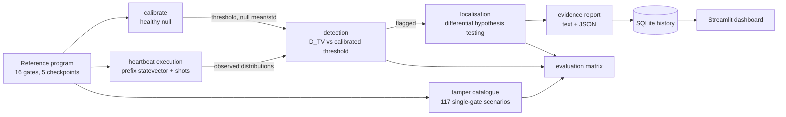

# Architecture

QuantumPulse is a monitoring layer that wraps a quantum circuit. It does not
change the algorithm; it re-executes short prefixes of the *expected* circuit
at chosen boundaries ("heartbeats") and compares each result with a calibrated
reference distribution.

The design goal is a prototype that is **small enough to reason about** and
**honest about what it measures**. Every number in this repository is produced
by code in `src/quantumpulse/`, and the pipeline used by the dashboard, the CLI
and the evaluation harness is the same pipeline.

---

## 1. Pipeline

```
                 ┌──────────────────────────────────────────────┐
                 │  reference program (declarative, 16 gates)   │
                 │  gates have stable ids g00..g15              │
                 │  5 checkpoints at fixed positions            │
                 └───────────────┬──────────────────────────────┘
                                 │
        ┌────────────────────────┼────────────────────────┐
        │                        │                        │
        v                        v                        v
  ┌───────────┐          ┌──────────────┐         ┌────────────────┐
  │ calibrate │          │  heartbeat   │         │  tamper        │
  │ (healthy  │          │  execution   │         │  catalogue     │
  │  null)    │          │ (prefix runs)│         │ (controlled)   │
  └─────┬─────┘          └──────┬───────┘         └───────┬────────┘
        │                       │                         │
        │   threshold τ,        │  observed distribution  │
        │   null mean/std       │  per checkpoint         │
        └───────────┬───────────┴─────────────┬───────────┘
                    v                         v
            ┌───────────────┐        ┌──────────────────┐
            │  detection    │        │  evaluation      │
            │  D_TV + cal.  │        │  matrix + metrics│
            │  threshold    │        └──────────────────┘
            └───────┬───────┘
                    │ flagged?
                    v
            ┌───────────────┐        ┌──────────────────┐
            │ localisation  │───────>│ evidence report  │
            │ differential  │        │ text + JSON      │
            │ hypothesis    │        └────────┬─────────┘
            └───────────────┘                 │
                                              v
                                   ┌────────────────────┐
                                   │ SQLite history     │
                                   │ + Streamlit        │
                                   └────────────────────┘
```



---

## 2. Module map

| Module | Responsibility | Key entry points |
| --- | --- | --- |
| `config.py` | Every tunable parameter, as serialisable dataclasses. Noise profiles. | `NoiseConfig`, `NOISE_PROFILES`, `ExperimentConfig`, `MonitorConfig` |
| `program.py` | Declarative circuit model. Gates carry stable ids so a checkpoint position never shifts. | `GateSpec`, `Checkpoint`, `QuantumPulseProgram.prefix/to_circuit/causal_gates` |
| `circuits.py` | The reference circuit and its checkpoint layout, with the design rationale. | `reference_program()`, `program_table()` |
| `backends.py` | Aer wrapper: shot-based counts and exact statevector probabilities. | `AerBackend.run_counts/exact_probabilities` |
| `execution.py` | Executes all checkpoints, returns observations + timing. | `run_heartbeats()`, `run_full_circuit()` |
| `detection.py` | Distance and goodness-of-fit statistics. | `total_variation_distance`, `chi_square_gof`, `compare_distributions` |
| `calibration.py` | Builds the healthy null per checkpoint and sets the threshold. | `calibrate()`, `BaselineProfile.save/load` |
| `verification.py` | Decision rule; turns observations into per-checkpoint verdicts. | `verify_heartbeats()`, `IntegrityVerdict` |
| `tampering.py` | Controlled single-gate modifications and their exact effect. | `build_tamper_catalog`, `apply_tamper`, `exact_effect`, `is_effectless` |
| `localization.py` | Ranks candidate gate locations by differential hypothesis testing. | `localize()`, `LocalizationReport` |
| `evaluation.py` | Runs the full matrix and computes every reported metric. | `run_evaluation()`, `ProfileMetrics` |
| `evidence.py` | Human-readable and machine-readable integrity report. | `build_report()`, `IntegrityReport.to_text/to_json` |
| `storage.py` | SQLite persistence for monitoring history. | `MonitoringStore` |
| `monitoring.py` | Periodic monitoring loop over the same pipeline. | `MonitorSession.run/check_once` |
| `ml.py` | **Optional** Isolation Forest detector, evaluated on identical runs. | `MLDetector`, `compare_detectors` |
| `dashboard.py` | Streamlit UI. Calls the same functions as the CLI. | `streamlit run src/quantumpulse/dashboard.py` |
| `cli.py` | Command-line entry point. | `quantumpulse {reference,calibrate,check,localize,evaluate,summarize,ml-evaluate,monitor,report}` |

### Why the program model is declarative

A tampering detector has to compare a run against *the circuit as it was
supposed to be*. Representing the circuit as data (`GateSpec` records with
stable `gid`s) instead of as Qiskit instructions gives three things:

1. **Stable positions.** Removing a gate marks `active=False` rather than
   deleting it. If a removal shifted later positions, every checkpoint after
   the removal would compare the wrong prefix against the baseline — a real bug
   that was caught and fixed during development.
2. **An enumerable hypothesis space.** Localisation needs to construct "the
   circuit with gate *g* replaced by *h*". That is a data edit, not a patch to
   a compiled circuit.
3. **Provenance.** `fingerprint()` hashes the program, so a baseline can refuse
   to be used with a different circuit.

---

## 3. Execution model

A heartbeat round executes one short circuit per checkpoint:

| Checkpoint | Position | What it covers |
| --- | --- | --- |
| `CP-PREP` | 3 | after preparation |
| `CP-ENT` | 6 | after nearest-neighbour CNOTs |
| `CP-ROT` | 8 | after mid-circuit rotations |
| `CP-OUT` | 12 | algorithm output, before readout rotations |
| `CP-FINAL` | 15 | full circuit (the traditional output-only check) |

Each prefix is run with `shots` shots and the counts are converted to a
probability vector over `2^n` outcomes. Because the reference circuit has no
mid-circuit measurement, a prefix re-execution reproduces exactly the state the
full circuit would hold at that boundary — the heartbeat is a *measurement* of
the intermediate state, not an approximation of it.

Cost is therefore linear in the number of checkpoints: five prefixes where an
output-only check needs one. The measured ratio is reported in
[`results.md`](results.md).

Bit convention: the integer value of a Qiskit count key equals the
`Statevector` index (qubit 0 is the least-significant bit). No string reversal
is applied, and there is a test that pins this down (`tests/test_detection.py`),
because inverting it silently destroys the distance measurement.

---

## 4. Detection

For each checkpoint the monitor computes the total variation distance between
the observed distribution and the calibrated reference, and compares it with a
threshold derived from the empirical healthy null. The full derivation, the
p-value construction and the identifiability argument are in
[`method.md`](method.md).

Only the total variation distance drives the decision; the chi-square test is a
supplementary, optional corroboration (`--rule tvd+chi2`), because chi-square
requires binning choices that total variation avoids.

---

## 5. Localisation

1. The **first deviating checkpoint** bounds the search to the gates applied
   before it (`causal_gates`).
2. Every candidate gate is mutated in turn: replacements, removals and angle
   alterations, from the same documented catalogue used by the evaluation.
3. Each hypothesis predicts a distribution at every deviating checkpoint. The
   candidate score is the **mean** distance across those checkpoints.
4. Candidates are ranked and a **tie group** is reported when several are
   within `2 * null_std` of the best.

Step 3 matters: the map from single-gate modifications to output distributions
is not injective, and a decision that uses only the first deviating checkpoint
is sometimes a coin flip. Measured on the full catalogue with everything else
fixed (`scripts/fusion_ablation.py`), fusing three checkpoints instead of one
raises strict top-1 from **0.853 to 0.954** and cuts the ambiguity rate from
**23.9% to 8.3%**; a fourth and fifth checkpoint add nothing on this circuit.
See [`results.md`](results.md) §3.

An important honest caveat: if two modifications are **exactly** equivalent for
the circuit, no number of shots will separate them. The monitor reports that
tie instead of inventing a winner, and the circuit was redesigned to remove
such equivalences where it could (the readout layer). This is discussed in the
results.

---

## 6. Evaluation

`run_evaluation` sweeps:

* noise profiles: `ideal`, `depolarizing_mild`, `depolarizing_strong`, `thermal`;
* the full tampering catalogue;
* several independent trials per scenario plus a larger set of healthy runs
  (the false-positive rate is estimated from those).

For every tampered run it does **both** a heartbeat check and an output-only
check, and localises under both (the output-only search must consider the whole
circuit). That is what makes the heartbeat→localisation claim measurable rather
than asserted.

Outputs: `evaluation.json`, `trials.csv`, `metrics.csv`.

---

## 7. Known limitations

These are properties of the prototype, stated deliberately:

* **Single-gate hypothesis space.** Localisation searches one modified gate at
  a time. Two simultaneous modifications would not be found by this search.
* **Simulation only.** All results come from Qiskit Aer with explicit noise
  models. Real hardware has drift, crosstalk and gate-dependent errors that
  these models only approximate.
* **Trusted reference.** If the reference program or the baseline is
  compromised, the monitor is defeated. The fingerprint checks consistency, not
  authenticity.
* **Stationary noise.** The threshold assumes healthy runs are exchangeable
  with the calibration runs. Drift requires re-calibration.
* **Fixed shot count.** Thresholds are calibrated for a specific shot count and
  the verifier refuses to compare across different shot counts.
* **Cost.** Heartbeat checking costs one execution per checkpoint.
* **Not a proof of malice.** A detected deviation is evidence of behavioural
  change, not proof of an attack.
